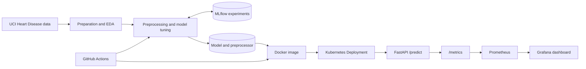

# Heart Disease Prediction Pipeline
## MLOps Project Report

**Academic context:** BITS Pilani MLOps assignment<br>
**Project type:** Educational machine-learning operations pipeline
**Primary task:** Binary classification of heart disease presence

> **Disclaimer:** This project is for educational and demonstration purposes only. The model is not a medical device, and its outputs are not medical advice, diagnosis, or a substitute for professional clinical judgment.

## Abstract

This report describes an end-to-end MLOps pipeline for binary heart disease prediction using the UCI Heart Disease datasets. Four regional datasets are consolidated into a common tabular format, explored, and prepared for supervised learning. Logistic Regression and Random Forest classifiers are tuned with stratified cross-validation and evaluated on a separate hold-out partition. MLflow provides experiment tracking, while a FastAPI service exposes health, prediction, and Prometheus-format metrics endpoints. Docker packages the application and its model artifacts, and Kubernetes manifests define a two-replica deployment and Prometheus/Grafana monitoring. GitHub Actions automates dependency installation, linting, tests, model training, artifact verification, Docker image building, and a container smoke test.

## 1. Introduction

Machine-learning projects require more than fitting a model. A usable system must manage data preparation, reproducible training, evaluation, artifact storage, inference, deployment, and operational monitoring. MLOps applies software-engineering and operations practices to machine-learning workflows to improve traceability, repeatability, and maintainability.

The **Heart Disease Prediction Pipeline** demonstrates these principles in an academic setting. Its implementation uses Python, pandas, and scikit-learn for data and modeling; MLflow for experiment tracking; FastAPI for inference; Docker and Kubernetes for packaging and deployment; pytest and Flake8 for quality checks; GitHub Actions for continuous integration; and Prometheus-compatible instrumentation for service metrics.

### Architecture overview



GitHub Actions currently validates, trains, and smoke-tests the image; it does not publish or deploy it automatically. The full architecture diagram and component details are also documented in `notebooks/mlops_architecture.ipynb`.

## 2. Problem Statement

The project uses clinical measurements from the UCI Heart Disease dataset to build a supervised classifier that predicts whether a record indicates heart disease. The original diagnosis field contains values from 0 through 4. The project maps this to a binary target:

- `0`: no heart disease
- Original values `1`, `2`, `3`, and `4`: heart disease, mapped to `1`

The engineering objective is to create a reproducible pipeline that prepares the data, compares candidate models, retains the necessary inference artifacts, and makes predictions available through an HTTP API. The task is a software and machine-learning demonstration; it does not establish clinical validity or support medical decision-making.

## 3. Dataset Description

The data preparation workflow combines four regional files from the [UCI Machine Learning Repository Heart Disease collection](https://archive.ics.uci.edu/dataset/45/heart+disease):

| Dataset | Source file |
|---|---|
| Cleveland | `data/raw/processed.cleveland.data` |
| Hungarian | `data/raw/processed.hungarian.data` |
| Switzerland | `data/raw/processed.switzerland.data` |
| VA Long Beach | `data/raw/processed.va.data` |

The unified prepared dataset is stored at `data/raw/heart.csv`. It contains 920 records and 14 columns: 13 predictors and one binary target.

| Feature | Description in the project schema |
|---|---|
| `age` | Age |
| `sex` | Sex code |
| `cp` | Chest pain type code |
| `trestbps` | Resting blood pressure |
| `chol` | Serum cholesterol |
| `fbs` | Fasting blood sugar indicator |
| `restecg` | Resting electrocardiographic result code |
| `thalach` | Maximum heart rate achieved |
| `exang` | Exercise-induced angina indicator |
| `oldpeak` | ST depression induced by exercise relative to rest |
| `slope` | Slope of the peak exercise ST segment code |
| `ca` | Number of major vessels visualized by fluoroscopy |
| `thal` | Thalassemia test result code |
| `target` | Binary outcome: 0 no disease, 1 disease |

The source data uses `?` for unknown values. The combined dataset contains 1,759 missing feature cells and two duplicate rows as recorded during preparation and inspection. The prepared target distribution is 411 records in class 0 and 509 records in class 1 before duplicate removal in the downstream training cleaning stage. These source data characteristics are important when interpreting the results: records come from multiple regions, some fields are missing, and feature coding can represent categories even when stored as numbers.

The dataset can be obtained from the [UCI Heart Disease dataset page](https://archive.ics.uci.edu/dataset/45/heart+disease) or its [official archive](https://archive.ics.uci.edu/static/public/45/heart+disease.zip). The four `processed.*.data` source files are extracted under `data/raw/`; `notebooks/data_preparation.ipynb` combines them into the project CSV. The assignment repository also includes these source files and the prepared CSV.

## 4. Exploratory Data Analysis

Exploratory data analysis is documented in `notebooks/eda.ipynb`. It inspects the prepared dataset’s shape, columns, inferred data types, missingness, duplicate count, and target distribution. It also reviews feature distributions and selected feature-to-target relationships, including age, chest-pain type, and exercise-induced angina, and records correlation patterns.

The EDA is descriptive rather than inferential. Visual differences or correlations do not demonstrate causal effects or clinical value. The notebook preserves missing values and duplicates during exploration so that data-cleaning decisions remain explicit and are applied in the training workflow rather than silently changing the EDA input.

## 5. Data Preprocessing

The implementation in `src/preprocess.py` performs preprocessing in a train/test-safe sequence:

1. Load the prepared CSV and verify that the target column exists.
2. Convert columns to numeric values, coercing invalid representations to missing values.
3. Remove rows whose target is missing, since they cannot be used for supervised training.
4. Remove exact duplicate records and validate that the target contains only binary classes.
5. Separate the 13 predictors from the target.
6. Create an 80/20 stratified train/test split using random seed `42`.
7. Identify categorical features, including low-cardinality integer-coded features.
8. Median-impute and standardize numeric features.
9. Most-frequent-impute and one-hot encode categorical features, ignoring unseen categories at transform time.
10. Fit all transformations using only the training partition, then transform both partitions.
11. Save the fitted preprocessor to `models/preprocessor.pkl` for reuse by the API.

Fitting the imputer, scaler, and encoder only on training data reduces information leakage from the test partition. The same fitted transformation is later applied to API requests, helping maintain consistency between training and inference.

## 6. Model Development

Two scikit-learn models are compared using a stratified 80/20 train/test split and five-fold stratified cross-validation on the training partition:

### Logistic Regression

Logistic Regression is a linear classifier used as a relatively interpretable baseline. The project sets `random_state=42` and `max_iter=1000`, and searches `C` over `[0.1, 1.0, 10.0]`.

### Random Forest

Random Forest is an ensemble of decision trees that can represent nonlinear relationships and feature interactions. Its grid searches `n_estimators` over `[100, 200]`, `max_depth` over `[None, 10]`, and `min_samples_leaf` over `[1, 2]`.

Each search wraps preprocessing and classification in one scikit-learn pipeline, so imputers, scaling, and encoding are fitted within the training fold in each CV split. The search uses mean ROC-AUC to refit the best parameter setting within each model. The final candidate is selected by mean CV ROC-AUC, with mean CV F1 as a tie-breaker; the held-out test set is reserved for final evaluation. The comparison reports CV means and standard deviations, as well as test accuracy, precision, recall, F1 score, ROC-AUC, confusion matrices, and classification reports. The selected classifier is saved as `models/best_model.pkl`, its fitted preprocessor as `models/preprocessor.pkl`, and the comparison table as `models/model_metrics.csv`. Confusion-matrix figures are generated under `screenshots/`.

Training can be run from the repository root:

```bash
python src/train.py
```

## 7. MLflow Experiment Tracking

The MLflow-enabled training workflow is implemented in `src/train_mlflow.py`. It records a separate run for each candidate model and logs best search parameters, cross-validation and held-out test metrics, the fitted scikit-learn pipeline, confusion-matrix images, and the model comparison output. It selects and saves the model with the highest mean cross-validation ROC-AUC, using mean F1 as the tie-breaker.

Run the tracked workflow with:

```bash
python src/train_mlflow.py
```

When `MLFLOW_TRACKING_URI` is not configured, MLflow uses its local tracking store. A local user can start the tracking interface with:

```bash
mlflow ui --backend-store-uri ./mlruns --host 127.0.0.1 --port 5000
```

For collaborative or production use, a durable and access-controlled tracking backend should be configured. The local run store is not a substitute for a managed registry or a defined model promotion process.

## 8. API Development Using FastAPI

The inference service is implemented in `app/main.py`. At application startup, its lifespan handler checks for and loads the model and preprocessor artifacts. Startup fails explicitly if required files are absent, unreadable, or do not expose the expected prediction/transform methods.

The API validates request fields with Pydantic, constructs a one-record feature frame, aligns it with the feature order expected by the fitted preprocessor, transforms the input, and obtains a prediction and class-1 probability. It returns the binary class, readable label, and probability. HTTP middleware logs each request's method, path, status code, duration, and client address.

| Method and path | Function |
|---|---|
| `GET /` | Returns API information and endpoint hints |
| `GET /health` | Returns healthy when model and preprocessor artifacts have loaded |
| `POST /predict` | Returns a binary prediction and positive-class probability |
| `GET /metrics` | Exposes Prometheus-format HTTP instrumentation |
| `GET /docs` | Provides interactive Swagger documentation |

Run locally after training:

```bash
python -m uvicorn app.main:app --host 0.0.0.0 --port 8000
```

Example prediction request:

```bash
curl -X POST http://127.0.0.1:8000/predict \
  -H "Content-Type: application/json" \
  -d '{
    "age": 63.0,
    "sex": 1,
    "cp": 1,
    "trestbps": 145.0,
    "chol": 233.0,
    "fbs": 1,
    "restecg": 2,
    "thalach": 150.0,
    "exang": 0,
    "oldpeak": 2.3,
    "slope": 3,
    "ca": 0.0,
    "thal": 6.0
  }'
```

The response follows this schema; actual values depend on the locally generated model artifacts:

```json
{
  "prediction": 1,
  "prediction_label": "Heart Disease",
  "probability": 0.73
}
```

## 9. Docker Containerization

The Dockerfile uses `python:3.11-slim`, installs dependencies, copies the project into `/app`, and starts Uvicorn on port 8000. It sets unbuffered output for container logs and runs as an unprivileged user. The image must include the model and preprocessor files at build time because the API loads them on startup.

Example:

```bash
python src/train.py
docker build -t heart-disease-api:latest .
docker run --rm -p 8000:8000 heart-disease-api:latest
```

The `.dockerignore` excludes development state and local caches while allowing the application code and required model artifacts into the build context. The `.pkl` model artifacts are generated locally and git-ignored; they need to be generated or provisioned before building a deployable image.

## 10. Kubernetes Deployment

The Kubernetes configuration consists of an API Deployment and Service, plus a Prometheus/Grafana monitoring stack:

- The Deployment runs two replicas of the FastAPI container.
- The API Service uses type `LoadBalancer`, port 80 targeting container port 8000; an external address depends on cluster support.
- Startup, readiness, and liveness probes call `/health`.
- CPU and memory requests/limits are declared.
- The container security context disables privilege escalation, drops Linux capabilities, and uses a read-only root filesystem with a temporary writable volume.
- A rolling-update strategy is configured.
- Prometheus scrapes the API every 15 seconds. Grafana is provisioned with the Prometheus data source and a basic API dashboard.

Create the Grafana admin-password Secret securely before applying the manifests. A load-balancer address requires support from the local or cloud cluster; port-forwarding remains available as a local fallback. Apply the manifests with:

```bash
kubectl apply -f kubernetes/
kubectl rollout status deployment/heart-disease-api
kubectl get pods -l app=heart-disease-api
kubectl get service heart-disease-api
kubectl rollout status deployment/prometheus
kubectl rollout status deployment/grafana
```

The internal service can be inspected from a local machine using:

```bash
kubectl port-forward service/heart-disease-api 8001:80
```

Then `http://127.0.0.1:8001/docs`, `/health`, and `/metrics` can be accessed locally. To inspect the Prometheus scrape target, forward `service/prometheus` to port 9090 and open `http://127.0.0.1:9090/targets`. To use the provisioned Grafana dashboard, forward `service/grafana` to port 3000 and sign in using the password in the Kubernetes Secret. The current API manifest uses `heart-disease-api:latest`, appropriate for the demonstrated local workflow; a shared cluster should use a registry-qualified immutable tag and appropriate registry credentials.

## 11. Monitoring with Prometheus

The API integrates `prometheus-fastapi-instrumentator` and exposes HTTP request instrumentation at `/metrics`. The endpoint returns Prometheus text format and is hidden from the generated OpenAPI schema. It can be verified locally or through a Kubernetes port-forward:

```bash
curl http://127.0.0.1:8000/metrics
```

The Kubernetes monitoring manifest deploys Prometheus and configures a 15-second scrape interval for the API Service. Grafana is provisioned with a Prometheus data source and a dashboard showing target status and HTTP request rate. Time-series and dashboard storage are ephemeral; persistent volumes and alert rules are not configured. MLflow experiment tracking and Prometheus runtime metrics address different concerns: model-development history versus API operational behavior.

## 12. CI/CD Pipeline

The GitHub Actions workflow at `.github/workflows/ci.yml` runs on pushes and pull requests targeting `main`. The job:

1. Checks out the repository and configures Python 3.11.
2. Installs dependencies from `requirements.txt`.
3. Runs Flake8 lint checks and the pytest suite.
4. Verifies required source files and the Dockerfile.
5. Trains and tunes the model using stratified cross-validation and checks that model and preprocessor artifacts were created.
6. Builds the Docker image with plain build output.
7. Runs the container and verifies `/health` and a sample `/predict` response.
8. Uploads model and screenshot artifacts with a 14-day retention period.

Any failed command stops the job. The current pipeline builds a Docker image but does not push it to a container registry or deploy it to Kubernetes. Those steps require registry configuration, secure credentials, and deployment-specific approval and access controls.

## 13. Results and Evaluation

The current saved comparison in `models/model_metrics.csv` reports five-fold stratified cross-validation and held-out test metrics:

| Model | CV ROC-AUC (mean ± SD) | CV F1 (mean ± SD) | Test accuracy | Test precision | Test recall | Test F1 | Test ROC-AUC |
|---|---:|---:|---:|---:|---:|---:|---:|
| Logistic Regression | 0.8789 ± 0.0439 | 0.8304 ± 0.0251 | 0.8315 | 0.8257 | 0.8824 | 0.8531 | **0.9213** |
| Random Forest | **0.8809 ± 0.0481** | **0.8442 ± 0.0239** | **0.8696** | **0.8545** | **0.9216** | **0.8868** | 0.9179 |

Random Forest has the higher mean CV ROC-AUC and mean CV F1 in the current search and is selected by the stated rule. Test-set metrics are shown separately and are not used for selection. The hold-out test split is a single partition with random seed `42`; it is not a confidence interval or independent clinical validation.

The API returns the predicted binary class and a probability for class `1`. That probability is a model score and should not be interpreted as a medically calibrated risk estimate without additional calibration and clinical validation. Performance may vary across populations, data collection settings, and thresholds.

## 14. Challenges Faced

The implementation addresses several practical challenges typical of tabular ML deployment:

1. **Combining heterogeneous datasets:** Regional source files must be aligned to a common 14-column schema, even though they have different amounts of missing data.
2. **Missing and duplicate records:** The source representation uses `?`; the combined dataset has 1,759 missing cells and two duplicate rows. The training pipeline explicitly coerces invalid values, removes unusable targets and duplicates, and imputes feature values.
3. **Categorical fields stored as numbers:** Several integer-coded variables represent categories rather than continuous measurements. The preprocessor identifies low-cardinality integer-valued features and one-hot encodes them.
4. **Preventing data leakage:** Imputation, scaling, and encoding must be fitted only on training data. The preprocessing pipeline splits first and fits transformations on the training partition.
5. **Keeping inference consistent with training:** The API must load the matching fitted preprocessor with the model, preserve feature order, and validate inputs before prediction.
6. **Distributing generated artifacts:** Model binaries are excluded from Git, but the API and container require them. Training/artifact generation therefore precedes the CI image build, and deployment environments must make compatible artifacts available.
7. **Separating experiment and service monitoring:** MLflow records model experiments; the API exposes operational metrics and Prometheus scrapes them for Grafana. Durable metrics storage and alerting remain operational extensions.
8. **Distinguishing CI from deployment:** The workflow validates and smoke-tests an image; securely publishing and deploying it still requires registry and cluster configuration.

## 15. Conclusion

The Heart Disease Prediction Pipeline demonstrates a complete educational path from multi-source dataset preparation to model training, tracked experiments, containerized API inference, and Kubernetes configuration. Scikit-learn preprocessing is fitted without using test data, candidate models are evaluated with multiple metrics, and the API loads the selected model and its preprocessor as a matched artifact pair. Automated tests and linting add repeatable quality checks, while GitHub Actions builds a Docker image and Prometheus instrumentation exposes API metrics.

The work establishes a practical MLOps foundation, but it is not a production medical system. CI does not yet publish or deploy images, monitoring storage is ephemeral, and no alert rules are configured. The model scores are preliminary and require stronger validation before any application beyond coursework.

## 16. Future Scope

Potential extensions include:

- Pin and lock dependencies, and record Python/platform versions for reproducible environments.
- Add dataset versioning, lineage, checksums, and explicit provenance/license documentation.
- Expand evaluation with nested cross-validation, confidence intervals, calibration, threshold analysis, and external validation.
- Assess subgroup performance, fairness, and data drift with domain expertise.
- Add a model registry and an explicit model promotion/approval process in MLflow.
- Publish versioned or digest-pinned images to a container registry.
- Add an approval-gated GitHub Actions deployment workflow for Kubernetes.
- Add persistent Prometheus/Grafana storage, richer dashboards, and alert rules.
- Add API integration, load, and resilience tests, plus container and dependency vulnerability scanning.
- Establish secure configuration, secrets management, logging, and operational runbooks.
- Define retraining criteria and monitor model and service behavior over time.

## Appendix A: Project Evidence

The repository includes screenshots for exploratory analysis, API interactions, testing, CI, and the earlier local Kubernetes demonstration. The Kubernetes and GitHub Actions screenshots document the earlier demonstrated environment; after applying the updated `LoadBalancer` and Prometheus/Grafana manifests, capture fresh screenshots for final submission.

- [EDA target distribution](../screenshots/target_distribution.png)
- [EDA correlation heatmap](../screenshots/correlation_heatmap.png)
- [FastAPI Swagger UI](../screenshots/api/swagger_docs.png)
- [FastAPI prediction response](../screenshots/api/prediction_response.png)
- [Pytest results](../screenshots/Testing/pytest_results.png)
- [Earlier GitHub Actions success](../screenshots/cicd/github_actions_success.png)
- [Earlier Kubernetes demonstration](../screenshots/Kubernetes/kubernetesCMD.png)

The assignment also requests a short video recording of the complete workflow. A recording is not included in this repository and must be captured separately by the project author.
